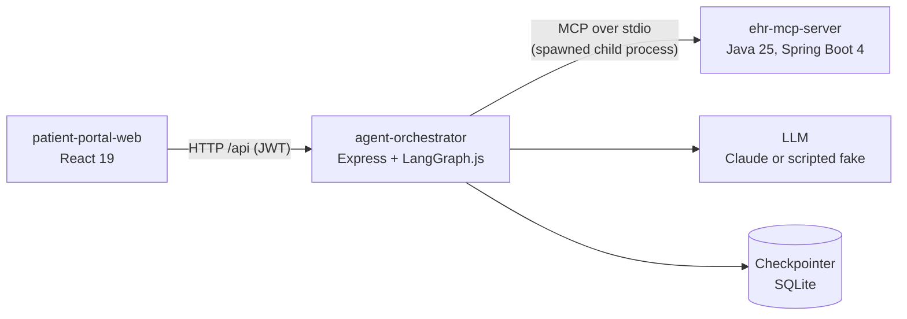
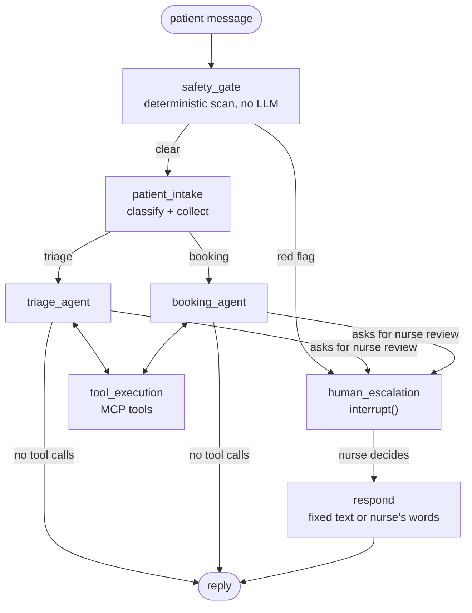
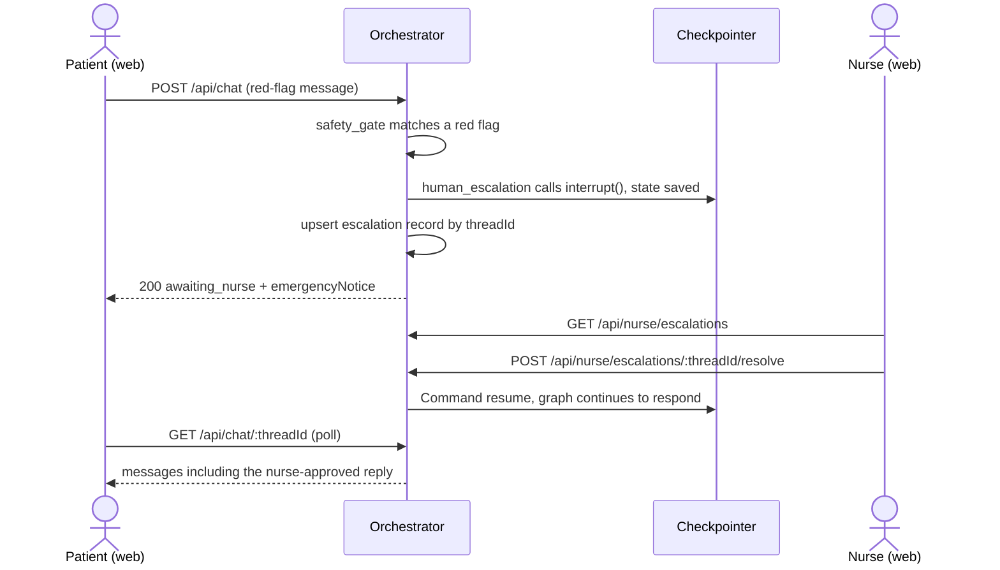

# Architecture

The orchestrator spawns the JAR once at startup and talks JSON-RPC over the child's stdin/stdout. Because stdout is the protocol channel, the Java server must never write anything else to it (see `CLAUDE.md`).

## Graph (Step 3)

- `safety_gate` and the static emergency notice do not depend on the LLM. It runs on every message, so an earlier escalation never carries over.
- The agents can ask for review by calling the local tool `request_nurse_review`. That sends the run to `human_escalation`, and nothing the model says can cancel an escalation.
- Each agent has a tool allowlist. `triage_agent` can read the history; only `booking_agent` can reach `ehr_book_appointment`, and only for a slot it proposed with `propose_booking` in an earlier turn that the patient has since replied to.
- `human_escalation` calls `interrupt()` first. On resume it closes every open tool call so the next model request stays valid.
- Each conditional edge is a router function with a string-literal-union return type (`graph/edges.ts`). The same lists are given to LangGraph, so a router or edge that names a missing node fails `tsc`.

## Persistence

One SQLite file (`node:sqlite`, built into Node, no native add-on) holds three things: LangGraph's checkpoints (`NodeSqliteSaver`), which thread belongs to which patient, and the nurse queue. Keeping them together means a pause and its queue entry survive a restart together. `PERSISTENCE=memory` keeps everything in memory instead.

## Escalation flow

LangGraph has no cross-thread "list paused runs" query, so the orchestrator keeps a small escalation table. The chat service writes it after any turn that ends paused (`openIfAbsent`: a thread has at most one pending escalation). A resolve is refused with `409` if the entry is not pending, and a per-thread lock stops two requests from racing.

## Transport

Stdio for dev and demo. A Streamable-HTTP profile is a documented option, not built (see `adr/0001-stdio-first-transport.md`).

## Web portal

One Vite app with two routes: `/` (patient chat) and `/nurse` (dashboard). The browser only ever talks to its own origin; in development Vite forwards `/api` to the orchestrator, and a production deployment would do the same with a reverse proxy, which is why the API has no CORS.

- **Held conversations.** After an escalation the patient's thread is `awaiting_nurse`. The chat disables its composer, shows the hold banner and polls `GET /api/chat/:threadId` every 3 seconds until the status is `responded`. The emergency notice is part of the thread, so a reload still shows it and the "Call 911" banner.
- **Nurse queue.** The list refreshes every 5 seconds, so new escalations appear without a reload. The detail view loads the transcript, the assistant's concern and its withheld draft, and offers approve, edit or reject.
- **Sessions are per tab** (`sessionStorage`), so one browser can hold a patient tab and a nurse tab at once.
